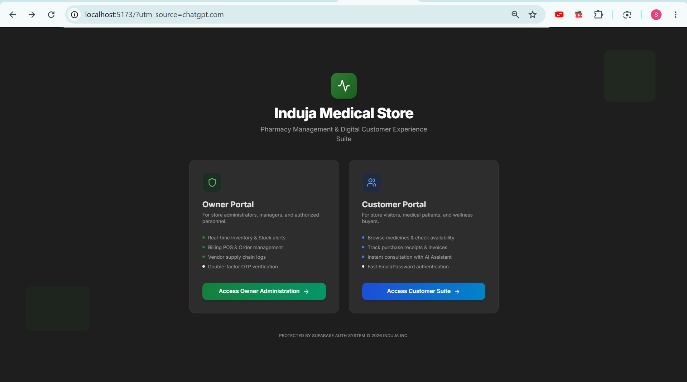
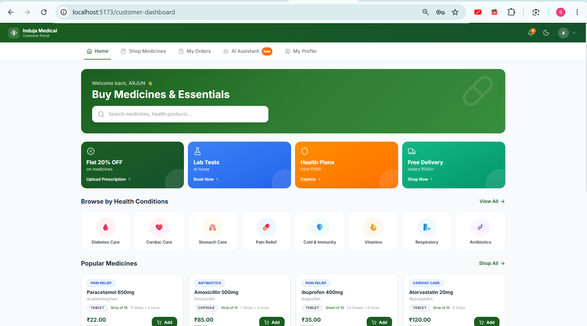
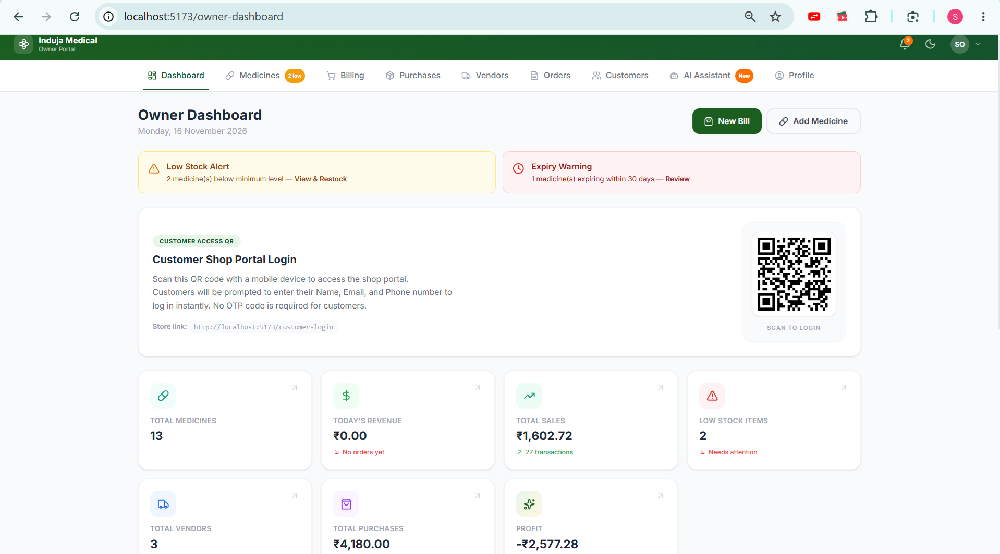

# Induja Medical Store – Pharmacy Management System

A web-based pharmacy management and medicine shopping application with separate Owner and Customer portals.

## Project Description

Induja Medical Store is a pharmacy management application designed to simplify daily medical store operations and provide customers with a convenient medicine shopping experience.

The system includes an Owner Portal for managing medicines, billing, inventory, vendors, purchases, and customer orders. The Customer Portal allows users to browse medicines, explore health products, and access their orders.

## Technologies Used

- React.js
- Vite
- JavaScript
- Tailwind CSS
- Supabase

## Key Features

### Owner Portal
- Inventory and medicine management
- Billing and sales tracking
- Low-stock and expiry alerts
- Vendor and purchase management
- Customer and order management
- Revenue and profit dashboard
- Customer portal QR code access
- AI Assistant interface

### Customer Portal
- Medicine search and browsing
- Health-based product categories
- Medicine pricing and shopping interface
- Customer orders
- Special offers and health services
- AI Assistant interface
- Customer profile management

## Project Screenshots

### Homepage

### Customer Dashboard

### Owner Dashboard

## How to Run

1. Download or clone the repository.
2. Open the project folder in Visual Studio Code.
3. Install the required dependencies:

   npm install

4. Configure the required environment variables.
5. Start the development server:

   npm run dev

6. Open http://localhost:5173/ in your browser.

## Project Status

The application has been tested locally using the Vite development server.
